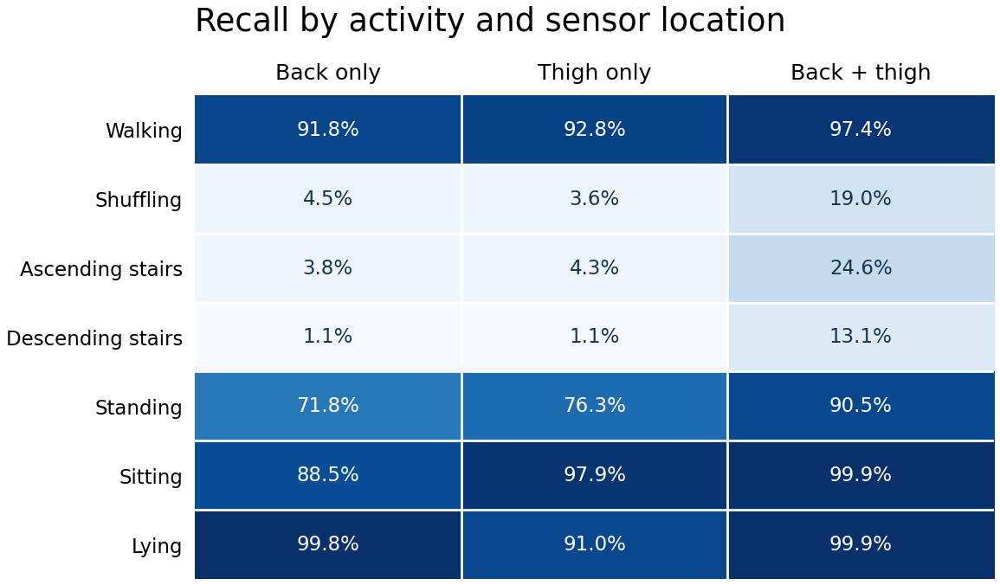

# Random forest results

## Full-cohort rerun

The study notebook's six-tree forest was evaluated on 2,259,593 smoothed readings from 18 participants. The original five-reading mean runs across the concatenated series, so four initial readings are lost. All three configurations use the same ten shuffled row-level folds (split seed 42). The classifier retains the original unset seed.

| Input | Accuracy | Macro precision | Macro recall | Macro F1 |
| --- | ---: | ---: | ---: | ---: |
| Back only | 85.17% | 0.5904 | 0.5161 | 0.5246 |
| Thigh only | 87.68% | 0.6002 | 0.5243 | 0.5326 |
| Back + thigh | 94.26% | 0.8448 | 0.6349 | 0.6768 |

Combining the sensors improved pooled accuracy by **9.08 percentage points over back alone** and **6.58 points over thigh alone** in this run. Each person contributes to both training and evaluation. The [distillation study](../../extensions/distillation/README.md) also reports a separate evaluation on four previously unseen people.

Each percentage is the share of readings for the named activity classified correctly. Activities contribute in proportion to their frequency to overall accuracy. Macro recall gives each of the seven activities equal weight, including the two rare stair classes.

[Per-fold scores](folds.csv) · [Pooled metrics, label order and confusion matrices](metrics.json) · [Console excerpts](logs/) · [Ablation commands](../analysis/README.md) · [Plot source](../analysis/plot_sensor_recall.py)

## Historical evidence

| Item | Where it comes from |
| --- | --- |
| Seven-model comparison | Cell 1 of the [original figure notebook](../notebooks/result-figures.ipynb) records logistic regression, Gaussian naive Bayes, random forest, QDA, MLP, CNN and LSTM. It plots manually entered values. |
| RF accuracy | The author's historical study summary reports 94.27%. The figure notebook enters 0.9428 (94.28%). This run produced 94.26%. The unseeded forest and environment affect repeat runs. The historical RF training notebook has no saved fold predictions. |
| Sensor comparison | The historical study summary reports single-sensor accuracies of 85.0% and 87.6%, and 94.4% for fusion. The table above gives independently computed scores on the archived six-tree configuration. |
| Preprocessing | The modeling cells compute five-reading trailing means. The archive also contains an outlier box-plot script and an exploratory variance-inflation analysis. It does not record an IQR-based row-removal step in the full-cohort RF training path. |
| CPU deployment | The original archive contains the study's model code. The new [distillation runs](../../extensions/distillation/README.md) provide separate measurements and checkpoints with their own split definitions. Each release checkpoint has a measured serialized size, held-out score, class map and training command. |

## Run details

The fused log comes from `python paper/notebooks/run_model.py rf`. The single-sensor logs come from the [ablation launcher](../analysis/sensor_ablation.py), which selects three feature columns before running the same RF cell. All three used Python 3.12.14, scikit-learn 1.8.0, NumPy 2.3.5 and pandas 2.2.3 on Linux. The archived scripts and notebooks keep their original models, hyperparameters and splits.

The [console excerpts](logs/) retain the scores from all ten folds, pooled metrics, class reports and confusion counts. The [source inventory](../source-manifest.tsv) and [data manifest](../../data/manifest.csv) identify the exact study inputs. The three neural model paths also completed training, evaluation and figure generation on a small synthetic fixture using Python 3.11 with TensorFlow CPU 2.15.1; that check establishes runtime compatibility.
